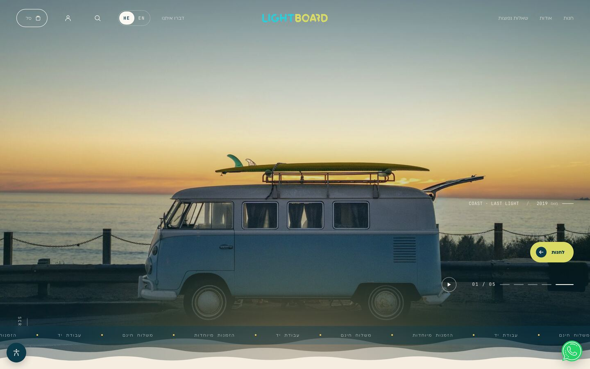
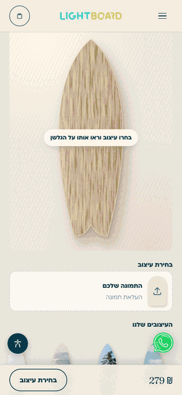
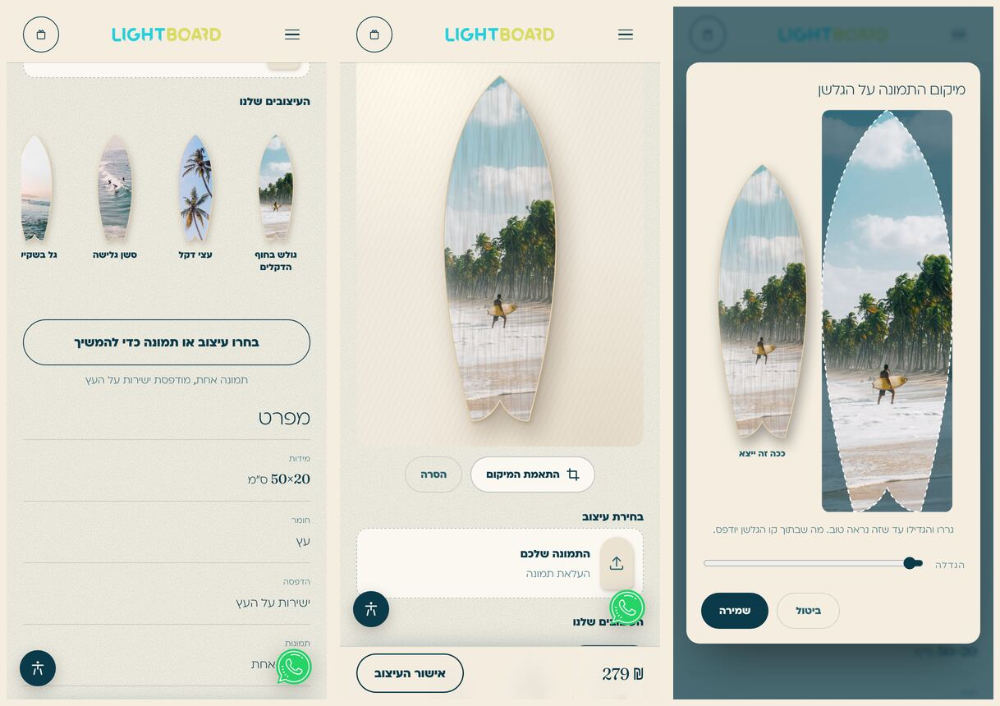
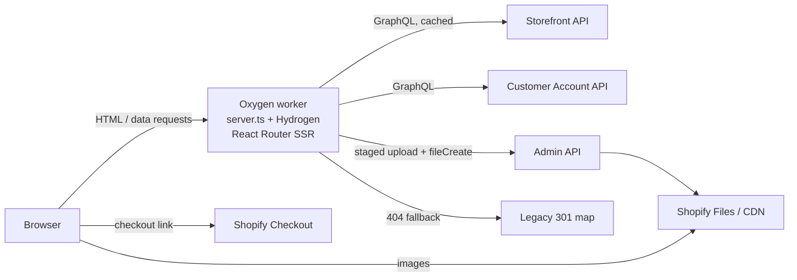
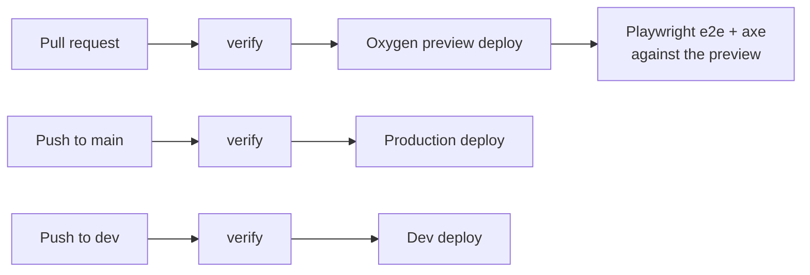
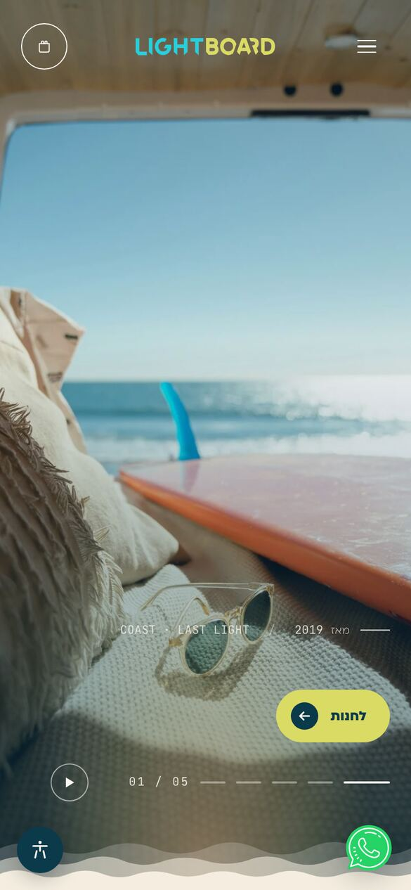
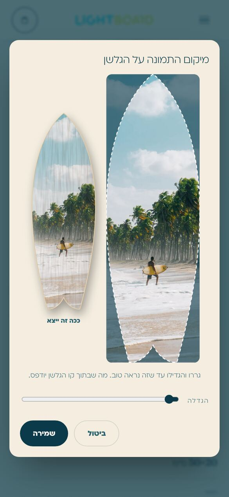
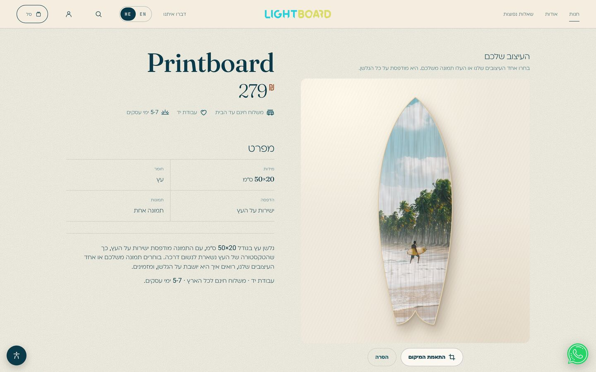
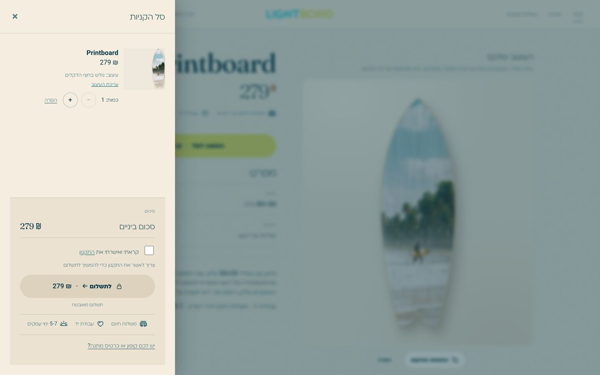
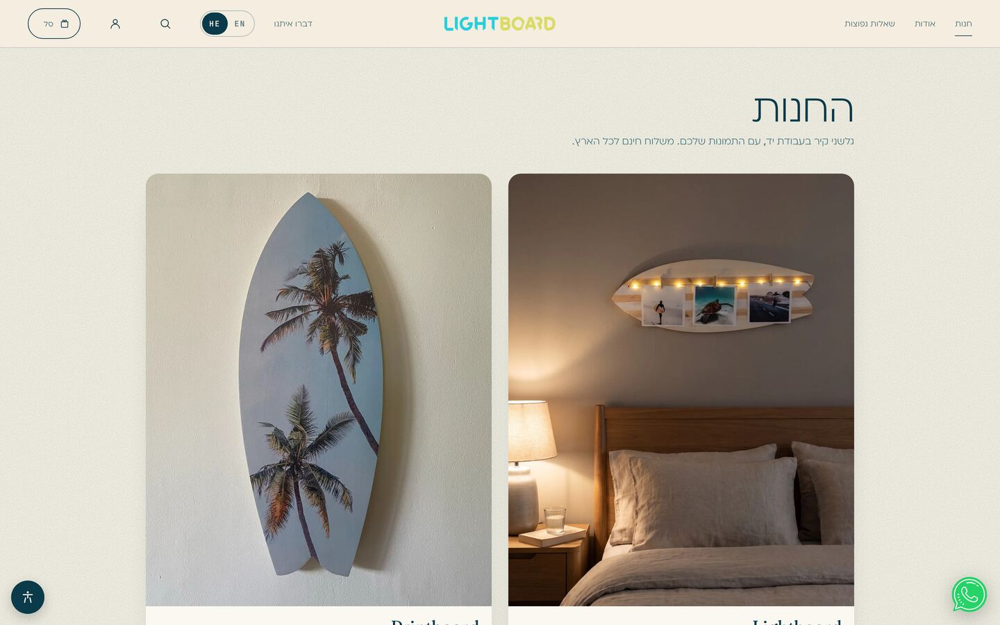

# Lightboard

Hebrew-first, headless Shopify storefront for a handmade surf wall-decor brand, with in-browser product customizers that turn a shopper's photo into a print-ready file.

[](https://github.com/idolevari/lightboard/actions/workflows/oxygen-deployment.yml)


**Live:** <https://lightboard.co.il> (Hebrew) · <https://lightboard.co.il/en> (English)



<p align="center">
  
</p>

<p align="center"><em>Printboard customizer: pick a design → live board preview → re-frame inside the real cutting outline.</em></p>

## What it is

A production storefront for a small brand that hand-makes wooden surfboard wall pieces in Tel Aviv. It replaced a WordPress + WooCommerce site and runs as a React Router SSR app on Shopify's edge (Oxygen), with Shopify as the commerce backend and CMS.

- **Hebrew first, right-to-left.** Hebrew at `/`, English under `/en`, with `dir`/`lang` switched per locale.
- **Two personalized products, one customizer component:**
  - **Lightboard**: a lit board with three of the shopper's photos clipped on. The shopper uploads (or lets the site pick) three photos, crops each to a square and sees them placed on the board image of the chosen color.
  - **Printboard**: a fish-tail board with one photo printed directly on the wood. The shopper uploads a photo or picks a ready-made design, and the preview shows it clipped to the board's real CNC cutting outline.
- Everything after "Add to cart" (checkout, payments, order emails) is Shopify's.

<p align="center">
  
</p>

## Engineering highlights

- **Live SVG board preview clipped to the real cutting file.** The Printboard outline is the studio's CNC path (516 points) stored once in [`app/lib/board-outline.ts`](app/lib/board-outline.ts). The same path drives the preview `clipPath`, the edge highlight and shadow, the crop-dialog overlay, the design tiles and the cart thumbnail, so what the shopper sees is the shape that gets cut.
- **Print-ready output from the browser.** Crops are rendered on `<canvas>` to fixed print sizes: 1200×1200 squares for the Lightboard and 2000×6147 (the board's aspect) for the Printboard. Large files are re-encoded at lower JPEG quality until they fit the 15 MB upload cap. Ready-made designs never upload: the order gets the CDN file, or a Shopify CDN region-crop URL if the shopper re-framed it.
- **Hardened upload endpoint** ([`api.photos.upload.ts`](app/routes/api.photos.upload.ts), [`photo-upload.server.ts`](app/lib/.server/photo-upload.server.ts)). It allows same-origin requests only (Fetch Metadata / `Origin`) and needs an HMAC-signed session "upload grant" issued by the product page loader. It rate-limits per session and per IP (Cache API counter), checks `Content-Length` before parsing the body, and caps each file's size. It sniffs magic bytes and rejects a mismatched `Content-Type`, strips GPS and XMP metadata from JPEGs without re-encoding, uses random UUID filenames, and returns fixed error codes to the client.
- **CSP and security headers.** Every HTML response gets a per-request nonce CSP (`object-src 'none'`, no `data:` images, localhost sources only in development builds), plus `Referrer-Policy` and a restrictive `Permissions-Policy`. Shopify-authored HTML is sanitized server-side with a narrow allowlist before it is rendered.
- **Consent-gated analytics.** The Shopify privacy banner collects consent. The Meta Pixel defines only an inline queue stub and injects `fbevents.js` after explicit marketing consent, so no request reaches Meta before that.
- **SEO and GEO.** One JSON-LD `@graph` per page (OnlineStore, WebSite, FAQPage, ProductGroup with variant Offers, MerchantReturnPolicy, BreadcrumbList). Pages carry canonical and `hreflang` (he / en / x-default) tags, and custom sitemaps use the production origin. `robots.txt` explicitly allows AI search crawlers. `/llms.txt` and `/llms-full.txt` are generated from live Storefront API data, and a legacy map 301s old WordPress/WooCommerce URLs.
- **Accessibility and performance.** The site has an RTL-aware accessibility menu (text size, contrast, link highlighting, readable font, stop animations). Latin text inside Hebrew is wrapped in `<bdi lang="en">` for screen readers, and dialogs trap focus. Animation is CSS-only (transform/opacity), pauses off-screen and turns off under `prefers-reduced-motion`. axe runs in CI on five key pages. Lighthouse mobile on a local production build (`/` and `/products/printboard`, 3 runs each) scores **100** for Accessibility, Best Practices and SEO, with 0 ms Total Blocking Time and CLS ≤ 0.002.
- **Shopify as the CMS.** Homepage copy, FAQs, testimonials, product specs and marketing copy are Shopify metaobjects and metafields with paired `_he` / `_en` fields. The merchant edits them in Shopify Admin, and changes appear within about a minute (60 s cache).

## Tech stack

| Layer | Choice |
|---|---|
| Framework | [Hydrogen](https://hydrogen.shopify.dev) 2026.4 on React Router 7 (SSR, file-based routes), React 18 |
| Language | TypeScript, `strict` |
| Build | Vite 6 |
| Hosting | Shopify Oxygen (edge workers): production, dev and per-PR preview environments |
| Commerce APIs | Storefront API (catalog, cart, metaobjects), Customer Account API (account pages), Admin API (Shopify Files uploads only) |
| Image handling | `react-easy-crop`, Canvas 2D, inline SVG; Shopify CDN image transforms |
| Sanitizing | `sanitize-html` (server-only; Workers runtime has no DOM) |
| Testing | Vitest (unit), Playwright + `@axe-core/playwright` (e2e, a11y) |
| CI/CD | GitHub Actions: reusable verify workflow, Oxygen deploys, SHA-pinned actions, Dependabot |

## Architecture



`server.ts` creates the Hydrogen context (Storefront client, cart, signed session, worker cache) for each request and hands it to React Router. Loaders query the Storefront API with explicit cache policies. The only write path is `POST /api/photos/upload`, which pushes customer photos to Shopify Files through the Admin API. If a route 404s, the worker tries the legacy WordPress redirect map and then Shopify's own URL redirects.



The deeper write-up covers the request lifecycle, caching, the customizer state machine, the security model and the trade-offs: **[docs/ARCHITECTURE.md](docs/ARCHITECTURE.md)**.

## Quality

- **`verify`** ([`.github/workflows/verify.yml`](.github/workflows/verify.yml)) is a reusable gate that runs before every deploy: `npm ci` → GraphQL codegen and React Router typegen, failing on any `*.generated.d.ts` drift → `typecheck` (app, e2e and unit-test tsconfigs) → `lint` → unit tests → production build.
- **Per-PR preview:** same-repo PRs deploy to a private Oxygen preview. Playwright then runs the e2e suite against that preview, using an Oxygen auth-bypass token that crosses jobs encrypted and is masked in logs. Fork and Dependabot PRs stop after `verify`, because they get no secrets.
- **Production:** a push to `main` runs `verify` and then deploys. Production deploys are serialized and never cancelled mid-flight.
- **Unit tests:** **110 tests in 12 files** (Vitest). They cover the customizer config and crop math, photo validation, upload guards and JPEG GPS scrubbing, HTML sanitizing, the launch-gate HMAC cookie, consent helpers, SEO URLs, hreflang and meta tags, the JSON-LD graph and legacy redirects.
- **End-to-end:** **23 scenarios in 6 spec files**, each run on a mobile (390×844, he-IL, touch) and a desktop project, for 46 test runs in total:
  - full Lightboard and Printboard purchase flows up to the checkout redirect, which is aborted so nothing is ever paid for
  - un-approve regressions
  - navigation and language toggle
  - platform checks: robots, sitemap, `llms.txt`, legacy 301, JSON-LD, production CSP, cross-origin upload rejection
  - axe scans

  The upload endpoint is always mocked, and the suite never writes to Shopify Files.
- **Dependencies:** Dependabot runs weekly for npm and GitHub Actions. Minor and patch updates are grouped. Major versions, and coordinated packages such as Hydrogen and the Shopify CLI, are left for manual migrations.
- **Security review:** a Claude security-review workflow comments on same-repo PRs.

## Project structure

```text
app/
  components/
    home/              Homepage sections (Hero, FeaturedProduct, Story, Faq, FinalCta, ...)
    product/           Product-page pieces (ProductHead, ProductSpecs, InYourHome)
    PhotoCustomizer/   PhotoCustomizer, BoardCanvas, PrintboardPreview, PrintboardStage, CropDialog
    illustrations/     Decorative SVG illustrations
    ...                Header, Footer, cart, search, AccessibilityMenu, JsonLd, ComingSoon
  graphql/
    storefront/        Homepage queries
    customer-account/  Customer Account API queries and mutations
  lib/
    .server/           Server-only: SEO graph, llms.txt, Admin API client, upload guards,
                       sanitizer, launch gate, legacy redirects, session
    i18n/              he.json / en.json (UI labels only)
    home/              Metaobject → homepage content mappers
    board-outline.ts   Printboard cutting path (single source of truth for the shape)
    customizer-config.ts, photo-canvas.ts, printboard-presets.ts, seo-urls.ts, meta.ts, ...
  routes/              File-based routes; customer paths live under the optional ($locale) segment
  styles/              app.css imports tokens, base, typography, motion, a11y, cart
    home/ layout/ pages/ product/
  entry.server.tsx     SSR stream + CSP / security headers
  root.tsx             Layout, analytics + consent, fonts, launch-gate short-circuit
server.ts              Oxygen fetch handler (context, session commit, 404 → redirects)
tests/unit/            Vitest unit tests
e2e/                   Playwright specs, fixtures and global setup
.github/               verify / deploy / security-review workflows, local deploy action, Dependabot
docs/                  Architecture notes and screenshots
```

## Getting started

**Requirements:** Node 24 (see [`.nvmrc`](.nvmrc); `engines` allows 22 or 24), npm, and access to a Shopify store with a Hydrogen storefront. The Shopify CLI is installed as a dev dependency.

```bash
npm install
npx shopify hydrogen link   # connect to the storefront and pull env vars into .env
npm run dev                 # http://localhost:3000 (GraphiQL at /graphiql)
```

### Environment variables

`.env` is gitignored. The same variables are set per environment in Oxygen.

| Variable | Purpose |
|---|---|
| `PUBLIC_STORE_DOMAIN` | The store's myshopify domain |
| `PUBLIC_STOREFRONT_ID` | Hydrogen storefront ID (analytics) |
| `PUBLIC_STOREFRONT_API_TOKEN` | Storefront API public token |
| `PRIVATE_STOREFRONT_API_TOKEN` | Server-only Storefront API token |
| `PRIVATE_SHOPIFY_ADMIN_API_TOKEN` | Admin API token limited to Files read/write, used only by the photo upload endpoint |
| `PUBLIC_CHECKOUT_DOMAIN` | Checkout domain (falls back to the store domain) |
| `PUBLIC_CUSTOMER_ACCOUNT_API_CLIENT_ID` | Customer Account API client |
| `PUBLIC_CUSTOMER_ACCOUNT_API_URL` | Customer Account API endpoint |
| `SESSION_SECRET` | Signs the session cookie and the launch-gate bypass cookie |
| `SHOP_ID` | Shop ID (populated by `hydrogen link`, typed in `env.d.ts`) |
| `COMING_SOON` | Optional. `'true'` turns on the launch gate |
| `PREVIEW_TOKEN` | Optional. Secret for `/preview?token=…` to bypass the launch gate |
| `META_PIXEL_ID` | Optional. Enables the consent-gated Meta Pixel |

### Scripts

| Script | What it does |
|---|---|
| `npm run dev` | Local dev server with codegen in watch mode |
| `npm run build` | Production build (with codegen) |
| `npm run preview` | Build and serve the production bundle locally in MiniOxygen |
| `npm run typecheck` | `tsc` for the app, e2e and unit-test projects |
| `npm run lint` | ESLint |
| `npm test` | Vitest unit tests |
| `npm run test:coverage` | Unit tests with V8 coverage over `app/lib` |
| `npm run e2e:install` | Install Playwright's Chromium (once) |
| `npm run e2e` | Playwright against `E2E_BASE_URL` (default `http://localhost:3000`) |
| `npm run codegen` | Regenerate Storefront / Customer Account types and React Router route types |

To run e2e against a production build:

```bash
npx shopify hydrogen preview --build --port 3120
E2E_BASE_URL=http://localhost:3120 npm run e2e
```

## Content model

The rule: if a merchant would edit it, it lives in Shopify. Code holds only UI plumbing.

- **Shopify:** catalog, prices, variants and policies, plus shop metafields for contact details and the featured product. Metaobjects hold the homepage hero and story, FAQs, testimonials, hero slides and product specs, each with paired `_he` / `_en` fields. English falls back to Hebrew, so a page never renders blank.
- **`app/lib/i18n/{he,en}.json`:** UI labels only: navigation, buttons, form and cart labels, ARIA labels, the accessibility menu.
- **Code:** programmatic constants: the board outline, swatch hex fallbacks, upload limits, magic-byte signatures, and fallback hero slides used until slides are configured in Shopify.

## More screenshots

| Mobile home | Crop dialog with board outline |
|---|---|
|  |  |







## License

Copyright © Ido Lev Ari. **All rights reserved.** The source is public for portfolio and reference purposes only. No license is granted to use, copy, modify or distribute the code, designs, brand assets or product photos. See [LICENSE](LICENSE).
