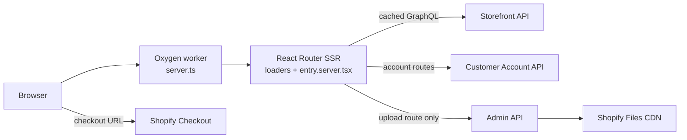
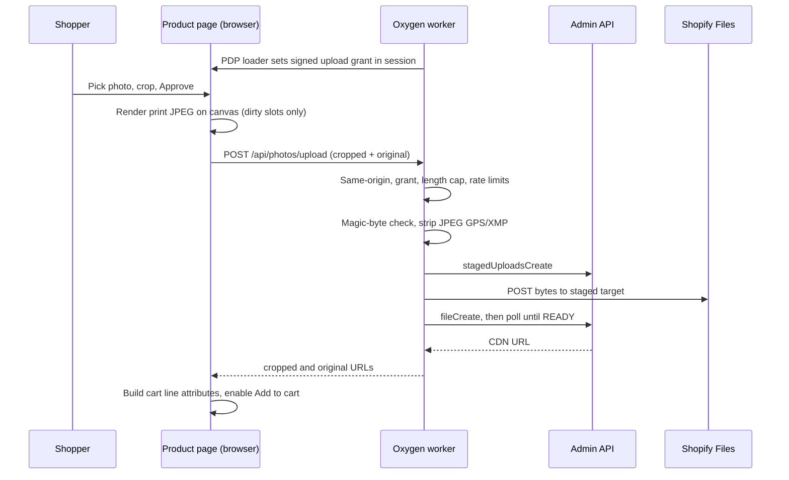
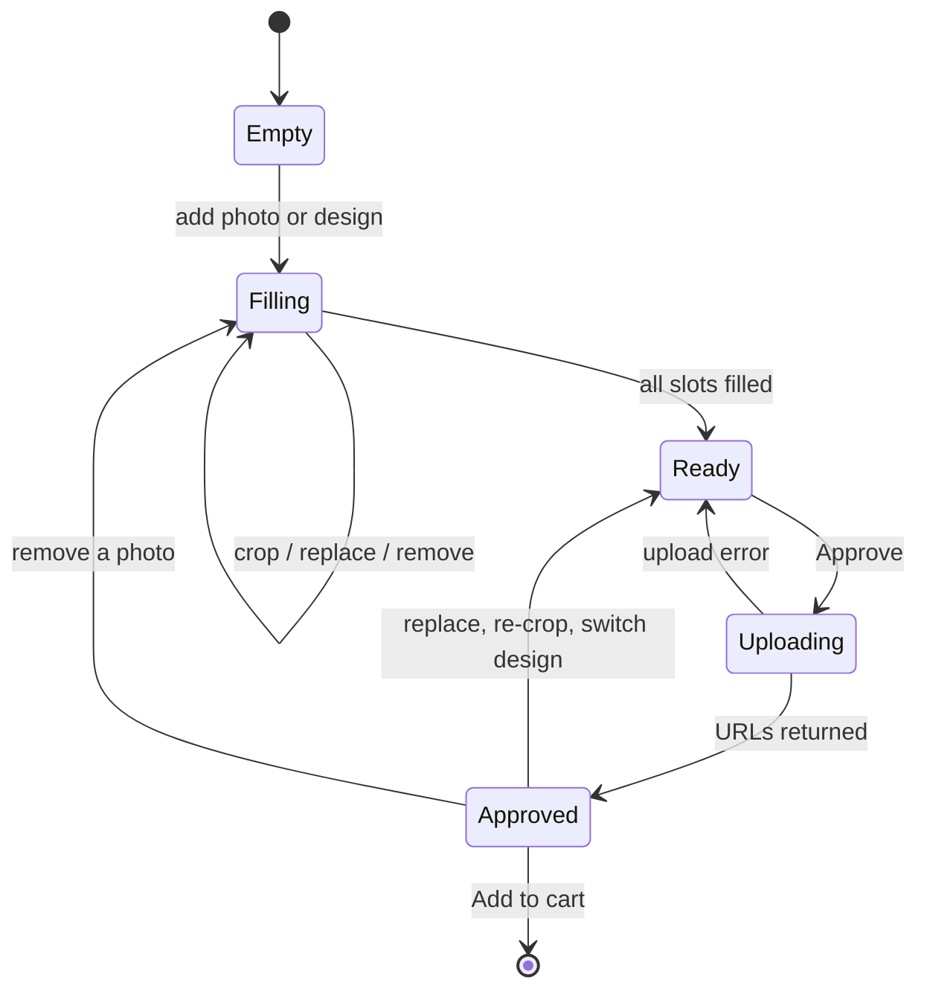

# Architecture

This document explains how the Lightboard storefront is put together and why. For setup and an overview, see the [README](../README.md).

## Contents

- [System overview](#system-overview)
- [Request lifecycle](#request-lifecycle)
- [Caching strategy](#caching-strategy)
- [Routing and i18n](#routing-and-i18n)
- [The product customizer](#the-product-customizer)
- [Security model](#security-model)
- [SEO and GEO](#seo-and-geo)
- [Launch gate](#launch-gate)
- [Testing strategy](#testing-strategy)
- [Deployment environments](#deployment-environments)
- [Key decisions and trade-offs](#key-decisions-and-trade-offs)
- [Known limitations and next steps](#known-limitations-and-next-steps)

## System overview



The app is a Hydrogen storefront: React Router 7 in framework mode, server-rendered inside a Shopify Oxygen worker (a Workers-style V8 isolate with no Node APIs and no DOM). Shopify does the commerce work. Catalog, cart, checkout, customer accounts, orders and content (metaobjects) all live there. The app owns presentation, the product customizers and one write endpoint for customer photos.

## Request lifecycle

1. **`server.ts`** is the worker's `fetch` handler. `createHydrogenRouterContext` (`app/lib/context.ts`) does three things in parallel: it opens the worker cache, initializes the HMAC-signed cookie session (`AppSession`), and primes the launch-gate cookie HMAC. It then builds the Hydrogen context: Storefront client, cart handler (with the cart query fragment) and an i18n block derived from the URL.
2. **React Router** matches the route. Every customer-facing route is nested under `($locale).tsx`, whose loader enforces the launch gate and validates the locale segment.
3. **Loaders** split data into *critical* (awaited, needed above the fold) and *deferred* (returned as promises and streamed into `<Suspense>` boundaries). Examples: the root awaits the header menu and defers the footer and cart. The homepage awaits the hero, products and story, and defers the FAQ.
4. **`entry.server.tsx`** renders with `renderToReadableStream`. Bots get the fully resolved stream (`body.allReady`), so crawlers see complete HTML. Every response gets a fresh CSP nonce and the security headers.
5. **Back in `server.ts`:** if the session changed, its cookie is committed. If the app returned **404**, the worker first checks the legacy WordPress redirect map, then Shopify's own URL redirects (`storefrontRedirect`), and only then passes the 404 through.

## Caching strategy

Caching happens at the **sub-request** level, through Hydrogen's Storefront client and the worker Cache API. Full HTML pages are not cached (see [trade-offs](#key-decisions-and-trade-offs)).

| Data | Policy | Why |
|---|---|---|
| Header and footer menus, policies, pages, blogs, collection index | `CacheLong` | Rarely changes |
| Product pages, collection grids, featured product, `llms.txt` data | `CacheShort` | Prices and availability should be fresh |
| Homepage metaobjects (hero, story, slides) and the Printboard card | `CacheCustom` public, `maxAge` 60 s, SWR 300 s | Merchant edits in Shopify Admin should appear in about a minute, not an hour |
| Cart, customer account | Not cached | Per visitor; account responses send `no-store` |
| `robots.txt`, sitemaps | `Cache-Control` 24 h | Static enough, cheap to regenerate |
| `llms.txt` / `llms-full.txt` | `Cache-Control` 1 h | Built from live data |
| Legacy 301s | `Cache-Control` 24 h | Permanent mapping |

## Routing and i18n

- **Hebrew is the default** and has no prefix (`/products/printboard`). **English** lives under `/en/...`. A `/he/...` URL redirects to the unprefixed path, and an unknown locale segment becomes a 404, which still goes through the redirect fallbacks.
- `app/lib/i18n.ts` defines each locale's `lang`, `dir` (`rtl` / `ltr`), Storefront `language` / `country` and the UI dictionary (`app/lib/i18n/{he,en}.json`). `root.tsx` sets `<html lang dir>` from it, and the Hydrogen context passes it to the Storefront API so prices and content come back localized.
- Merchant content is bilingual through paired metaobject fields (`title_he` / `title_en`, …). Mappers in `app/lib/home/content.ts` pick the field for the current locale and fall back to Hebrew, so a missing translation never renders an empty block.
- RTL details: CSS uses logical properties and RTL-aware layouts. `AutoLang` wraps Latin-only strings in `<bdi lang="en" dir="ltr">` so Hebrew screen readers switch voice and the text does not reorder.

## The product customizer

One component, `app/components/PhotoCustomizer/PhotoCustomizer.tsx`, serves both personalized products. Which mode it runs in depends on the product's **Shopify tags**, so the merchant can turn a product into a customizable one without a deploy:

```ts
// app/lib/customizer-config.ts
customizerKindForTags(tags) // 'requires-print-photo' → 'printboard', 'requires-photos' → 'lightboard'
```

### Config-driven kinds

| | Lightboard | Printboard |
|---|---|---|
| Slots | 3 | 1 |
| Crop aspect | 1 (square) | `BOARD_ASPECT` = 200 / 614.7 ≈ 0.3254 |
| Print output | 1200 × 1200 JPEG, q 0.9 | 2000 × 6147 JPEG, q 0.88 |
| Low-res warning below | 1200 px long edge | 2400 px long edge (~120 dpi over 50 cm) |
| Preview | Photos placed in per-color slot rectangles on the variant's board image (`BoardCanvas`) | SVG board clipped to the cutting outline (`PrintboardPreview`) |
| Extra sources | "Surprise me" curated CDN gallery | Five ready-made designs on the CDN (`printboard-presets.ts`) |

### Crop math

- `getDefaultCrop()` picks the largest rectangle of the target aspect that fits the photo, centered on a focal point and clamped to the image bounds.
- `maxPrintEdge()` computes the long edge of that largest crop. Comparing it against `recommendedPrintEdge` decides whether to accept the photo silently or with a low-resolution warning. Photos with a short side under 800 px are rejected.
- `PrintboardPreview` maps a crop rect in source pixels onto the 200 × 614.7 board viewBox with a scale (`W / crop.width`, `H / crop.height`) and a negative offset. The SVG `<image>` lands exactly where the print will, and the `clipPath` trims it to the board shape.
- The crop dialog (built on `react-easy-crop`) draws the cutting outline over the crop area and re-renders a live board preview on every pan and zoom.
- `renderCropUnderCap()` draws the crop to a canvas at the print size and exports a JPEG. If the result is over the 15 MB cap, it steps the quality down by 0.1, but never below 0.5.

### Upload flow

Uploads happen once, when the shopper presses **Approve**. Only slots that changed (`dirty`) are uploaded. Ready-made designs and "surprise me" photos are already on the CDN, so approving them uploads nothing. A re-framed design becomes a CDN region-crop URL instead.



The cart line carries `Photo N` attributes (print-ready CDN URLs). A Printboard line also carries either `Original photo` or the `Design` and `Design ID`, so the studio can print without contacting the customer. Original URLs and crop rectangles are also kept in `localStorage`, keyed by the first cropped URL, so **Edit** from the cart can re-open the customizer and re-crop from the original. The edit is saved with `CartLinesUpdate`.

### Approval state machine



Any change after approval calls `markUnapproved()`. That clears the approved flag and calls `onUnapprove`, so `ProductForm` drops the photo attributes and the buy button stops adding to the cart. The handlers are memoized, so they read approval state through refs; otherwise a stale closure would never un-approve. Two e2e regression tests cover this: one removes a photo after approval, the other switches design after approval.

## Security model

| Surface | Control |
|---|---|
| HTML responses | Nonce-based CSP via Hydrogen's `createContentSecurityPolicy`: `object-src 'none'`, `data:` disallowed for images, an explicit allowlist for Shopify CDN, Google Fonts and Meta. Localhost sources only when `process.env.NODE_ENV === 'development'`, which is a build-time constant because Oxygen does not inject `NODE_ENV`. An e2e test asserts the production CSP has no localhost. Also `Referrer-Policy: strict-origin-when-cross-origin` and a `Permissions-Policy` that disables camera, microphone, geolocation and USB |
| Merchant HTML | `sanitize-html` with a narrow allowlist (prose, lists, images, links) on the server only; strips event handlers, `javascript:` URLs, forms, iframes and scripts |
| Photo upload | Same-origin check (Fetch Metadata, falling back to `Origin`). HMAC-signed session grant from the PDP loader (7-day TTL). 10 uploads per session and 30 per IP per hour; the IP counter lives in the worker Cache API because Oxygen has no KV, and fails open. `Content-Length` checked before parsing. 15 MB per file. Magic bytes must match the declared type (JPEG / PNG / WebP). GPS IFD zeroed and XMP dropped in JPEGs without re-encoding, keeping the Orientation tag. UUID filenames. Fixed error codes to the client, details in server logs only. Returns 404 while the launch gate is on |
| Admin API | Used only by the upload route, with a dedicated custom-app token scoped to Files |
| Remote images in the browser | Re-crop from cart fetches only `https://cdn.shopify.com/` URLs, because cart attributes and `localStorage` are buyer-controlled |
| Analytics | Meta Pixel defines an inline queue stub only. `fbevents.js` is injected after explicit marketing consent from Shopify's Customer Privacy API |
| Supply chain and CI | Actions pinned by commit SHA. `persist-credentials: false`. Least-privilege `permissions`. Secrets never reach fork or Dependabot PRs. The preview bypass token is passed between jobs AES-encrypted and masked |

## SEO and GEO

- **Meta:** `routeMeta()` (`app/lib/seo-urls.ts`) gives every route the same canonical URL, `hreflang` alternates (he, en, x-default), Open Graph and Twitter tags. Home and product copy come from `app/lib/meta.ts`.
- **Structured data:** `siteJsonLd()` (`app/lib/.server/seo.server.ts`) builds a single `@graph` from live Shopify data: OnlineStore (with contact points and return policy), WebSite with SearchAction, FAQPage, a ProductGroup with per-variant Products and Offers (shipping details, return policy), and BreadcrumbList. `JsonLd.tsx` escapes it before inlining. The brand is always "Lightboard", whatever the Shopify Vendor field says.
- **Crawling:** a custom `robots.txt` explicitly allows AI and search agents (OAI-SearchBot, GPTBot, ClaudeBot, PerplexityBot, Google-Extended, Applebot, …). The sitemap index and child sitemaps always use the production origin, without Shopify's locale prefixes.
- **GEO:** `/llms.txt` and `/llms-full.txt` (`app/lib/.server/llms.server.ts`) are generated from the Storefront API (products, prices, colors, specs, FAQs, policies, contact) plus brand facts in code, so they cannot drift from the site.
- **Migration:** `legacy-redirects.ts` 301s old WordPress and WooCommerce slugs (Hebrew and English, products, pages, categories, feeds) to their closest live pages. It runs only on 404, so it can never shadow a live route.

## Launch gate

A server-enforced "coming soon" mode, used before launch and kept for maintenance:

- `COMING_SOON='true'` turns it on. When it is on, `root.tsx` returns minimal data (no header, footer, cart, shop or consent data), `($locale).tsx` redirects every non-root path to `/`, the homepage loader short-circuits and the upload route returns 404.
- **Bypass:** `/preview?token=<PREVIEW_TOKEN>` compares the token in constant time, then sets `lb_preview = HMAC-SHA256(SESSION_SECRET, "lb_preview:" + PREVIEW_TOKEN)` (HttpOnly, Secure, SameSite=Lax, 30 days). An unknown token returns 404. Rotating either secret revokes every issued cookie.
- The gate checks run synchronously inside loaders, but WebCrypto HMAC is async. The expected value is therefore computed once per isolate in `primePreviewCookie()` while the request context is built, and the check fails closed if that value is missing. Localhost always bypasses, so `npm run dev` works.

## Testing strategy

| Layer | Tool | Scope |
|---|---|---|
| Unit | Vitest (Node environment; DOM only where a file opts in) | Pure logic in `app/lib`: customizer config and crop math, photo validation, upload guards and EXIF GPS scrub, sanitizer, launch-gate HMAC and cookie, consent, SEO URLs and meta, JSON-LD graph and escaping, legacy redirects. **110 tests / 12 files.** |
| End-to-end | Playwright, mobile (390×844, he-IL, touch) and desktop (1440×900) projects | Real user journeys against a deployed build: both purchase flows up to the checkout redirect (aborted), un-approve regressions, navigation and language, platform contracts (robots, sitemap, llms.txt, 301s, JSON-LD, CSP, upload rejection). **23 scenarios × 2 projects.** |
| Accessibility | `@axe-core/playwright` (WCAG 2.0–2.2 A/AA tags) | Home, Lightboard PDP, Printboard PDP, shop grid, cart. Fails on serious or critical violations; minor findings are attached to the report |

Ground rules: the store is live, so e2e **never pays, never fills checkout, never creates accounts and never uploads**. The upload endpoint is mocked by a fixture that also counts calls, so a test can assert that a flow uploaded nothing. Reduced motion is forced so idle animations do not make elements unstable for clicks.

**Preview auth in CI:** Oxygen previews are private. The deploy step requests a one-hour auth-bypass token, encrypts it with the deployment token (GitHub drops job outputs that contain masked values) and passes it to the e2e job. The e2e job decrypts and masks it, and Playwright sends it as a header to the storefront origin only. If the preview has the launch gate on, global setup trades `E2E_PREVIEW_TOKEN` for the `lb_preview` cookie.

## Deployment environments

| Trigger | Pipeline | Target |
|---|---|---|
| Pull request into `main` or `dev` (same repo) | `verify` → preview deploy (`--preview`) → e2e | Private Oxygen preview, URL in the job summary |
| Fork or Dependabot PR | `verify` only | — |
| Push to `dev` | `verify` → deploy | Oxygen `dev` environment |
| Push to `main` | `verify` → deploy (GitHub `production` environment, serialized, never cancelled) | Production, <https://lightboard.co.il> |

`verify` is a reusable workflow, so production, dev and preview deploys run the same gate: codegen-drift check, typecheck, lint, unit tests and build. The deploy steps share a local composite action (`.github/actions/oxygen-deploy`). Node is pinned by `.nvmrc`.

## Key decisions and trade-offs

- **Headless Hydrogen instead of a Liquid theme.** The customizers need real application code: canvas rendering, SVG clipping, a stateful approval flow and a secured upload endpoint. The site also needed full control of RTL, structured data and performance. The cost is owning the frontend; checkout, payments and order management stay with Shopify.
- **Metaobjects as the CMS.** No extra CMS service or second bill. The merchant edits content where they already manage products. Paired `_he` / `_en` fields are a deliberate choice for one editor and two locales. Shopify Translate & Adapt would be the move for a third locale.
- **No full-page cache.** Each HTML response carries a per-request CSP nonce, and the layout includes per-visitor state (cart, consent). Caching happens per sub-request instead, with policies tuned to how often each kind of data changes.
- **Cache API for rate limiting.** Oxygen has no KV store. The per-IP counter is per data center and best-effort, which is enough for a cheap throttle. The signed per-session counter and the upload grant are the main controls.
- **Render print files in the browser.** The worker has no image library and tight CPU limits. Rendering on the client keeps the server a thin, validated pass-through and gives the shopper an instant preview of exactly what will print. The server still never trusts the client's MIME type and scrubs metadata.
- **`react-router` pinned above Hydrogen's declared range.** An npm `overrides` entry holds `react-router` / `@react-router/dev` at 7.18.x to pick up security advisories ahead of the next Hydrogen release. Major and quarterly Hydrogen upgrades are planned migrations, not Dependabot bumps.
- **One customizer, configured by product tag.** Adding a third personalized product means adding a config entry and a tag, not forking the component.

## Known limitations and next steps

- **Bot-resistant uploads.** The upload guards stop CSRF, hot-linking and scripted bulk abuse from one machine, but not a scripted real browser. The next step is a challenge such as Cloudflare Turnstile on Approve.
- **Preset aspect.** The ready-made design files are 2:5, slightly wider than the board's print area. The preview and the print both crop about 5% from each side.
- **Lightboard slot rectangles are coupled to the variant photos.** If a variant image is swapped in Admin, the per-color slot positions must be re-measured.
- **Lightboard re-edit from the cart is per device.** Lightboard originals and crop rectangles are kept only in `localStorage`, so on another device the edit flow has the cropped print files but not the originals or crop positions. Printboard lines are not affected: they carry the original URL or the design ID on the line itself.
- **Hero slides** use a code fallback until `hero_slide` metaobjects are created.
- **Catalog migration** from WooCommerce is in progress; pending products redirect to the catalog until they move.
- **Framework upgrade.** The next Hydrogen / Shopify CLI major is planned as a separate migration.
- **Lighthouse performance** is measured on a local production build only. Field data (CrUX) for the live domain is the better long-term signal.
